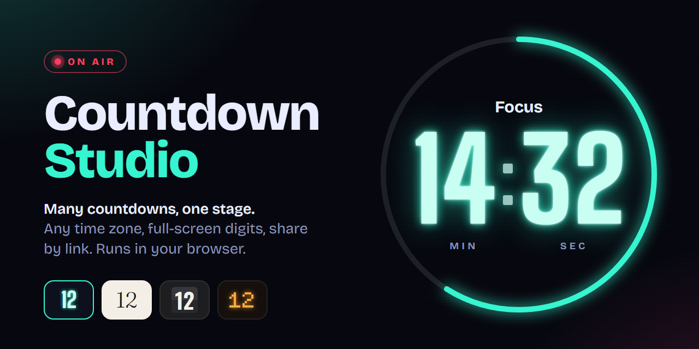
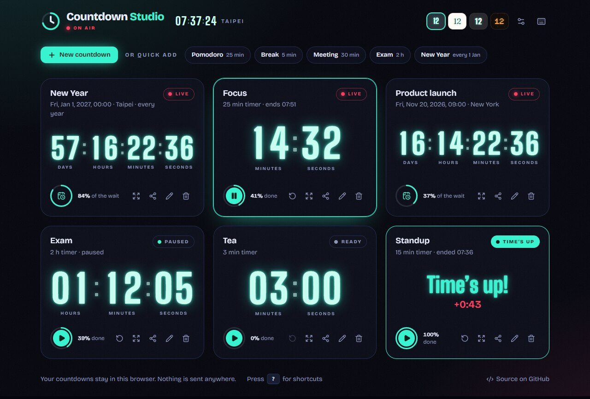
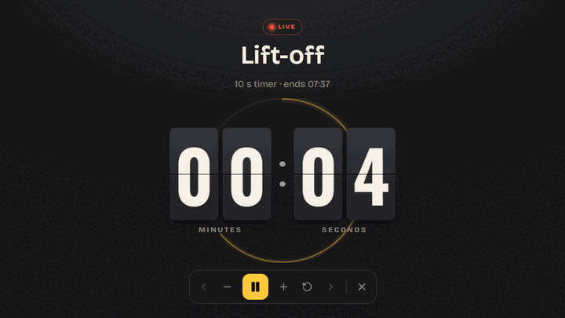
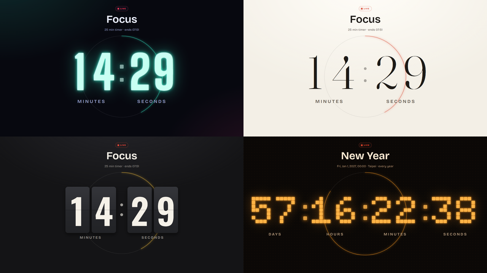
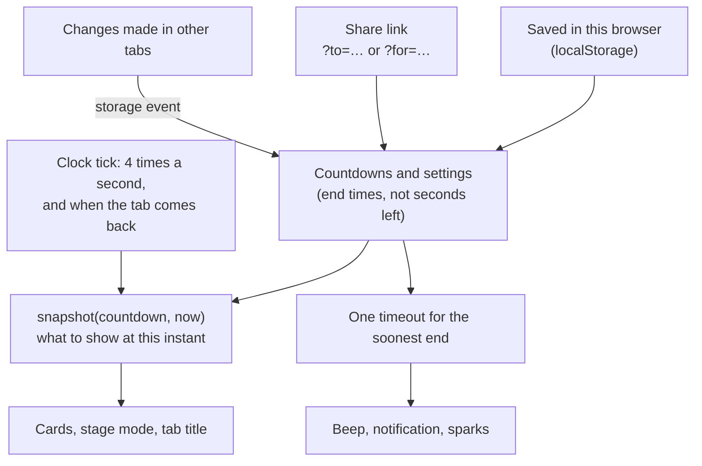

<p align="center">
  
</p>

# Countdown Studio

[](https://github.com/NatLee/countdown-studio/actions/workflows/deploy.yml)
[](LICENSE)


Countdown Studio keeps several countdowns running side by side: to a moment in any time zone
(a launch, an exam, New Year) or for a length of time (a pomodoro, a meeting). Put any of them
on a full-screen stage with digits you can read from the back of the room, send it to someone
as a link, and get the beep when time is up. There is no account and no server: everything runs
and stays in your browser.

**Live demo: <https://natlee.github.io/countdown-studio/>**



## What it does

- **Many countdowns at once.** Count down to a date and time in any time zone (optionally every
  year), or run timers you can start, pause, reset and stretch by a minute.
- **One-click presets.** Pomodoro (25 min), Break (5 min), Meeting (30 min), Exam (2 h) and New Year.
- **Stage mode.** One countdown, full screen, as big as the screen allows, with a progress ring.
  The controls hide when the mouse rests.
- **Four themes.** Neon, Minimal, Flip (split-flap cards that really flip) and LED.
- **When time is up:** the original beep (with volume and mute), an optional browser notification
  when you are in another tab, and a burst of sparks. The sparks and the flip animation stay off
  if your system asks for reduced motion.
- **Share by link.** Running timers are shared as their end time, so everyone sees the same countdown.
- **It remembers.** Countdowns and settings are saved in your browser and follow you across tabs:
  open stage mode in a second window on the projector and control it from your laptop.
- **Keeps the screen on** while a timer runs or stage mode is open (Screen Wake Lock).
- **Never drifts.** Every number is worked out from timestamps, so a countdown is still exact
  after your laptop sleeps or the browser slows down a background tab. The alarm still goes off
  on time when the tab is hidden.

## Quick start

### Use it online

Open the [live demo](https://natlee.github.io/countdown-studio/). That's it.

### Run it on your machine

You need [Node.js](https://nodejs.org/) 22.13 or newer (CI uses the version in `.nvmrc`).

```bash
git clone https://github.com/NatLee/countdown-studio.git
cd countdown-studio
npm ci
npm run dev        # http://localhost:5173
```

### Host it yourself with Docker

```bash
docker compose up --build              # http://localhost:8000
PORT=3000 docker compose up --build    # pick another port
```

The image builds the site and serves it with nginx (about 94 MB, no Node.js inside).

### Put it on any static host

```bash
npm run build      # writes the site to dist/
```

Upload `dist/` anywhere. Asset paths are relative, so it works at the root of a domain or under a
sub-path such as `/countdown-studio/` without any setting.

## Stage mode

Select a countdown and press <kbd>F</kbd> (or the expand button on its card). Press <kbd>Esc</kbd>
to leave. <kbd>←</kbd> and <kbd>→</kbd> switch between countdowns without leaving the stage.



## Keyboard shortcuts

Shortcuts act on the selected countdown (the one with the highlighted border). They pause while
you type in a field, and they leave <kbd>Ctrl</kbd>/<kbd>⌘</kbd> combinations to the browser.
Press <kbd>?</kbd> in the app to see this list.

| Key | What it does |
| --- | --- |
| <kbd>Space</kbd> | Start or pause the selected timer |
| <kbd>R</kbd> | Reset the selected timer |
| <kbd>+</kbd> / <kbd>−</kbd> | Add or take off a minute |
| <kbd>F</kbd> | Stage mode: the selected countdown, full screen |
| <kbd>Esc</kbd> | Leave stage mode or close a dialog |
| <kbd>←</kbd> / <kbd>→</kbd> | Select the previous / next countdown |
| <kbd>N</kbd> | New countdown |
| <kbd>E</kbd> | Edit the selected countdown |
| <kbd>S</kbd> | Share the selected countdown |
| <kbd>T</kbd> | Next theme |
| <kbd>M</kbd> | Sound on / off |
| <kbd>?</kbd> | Show the shortcuts |

## Share links

The share button builds the link for you, but the format is simple enough to write by hand.
Opening a link adds the countdown to the visitor's list (once; opening it again just selects it).

| Parameter | Meaning | Example |
| --- | --- | --- |
| `to` | A wall-clock time, read in `tz` | `to=2027-01-01T00:00` |
| `to` | …or an exact instant (`Z` or `±hh:mm` at the end) | `to=2026-11-04T09:30:00Z` |
| `tz` | IANA time zone for `to`; defaults to the visitor's | `tz=Asia/Taipei` |
| `repeat` | `yearly` rolls over to the same date next year | `repeat=yearly` |
| `for` | A timer length in `d`, `h`, `m`, `s` (instead of `to`) | `for=1h30m` |
| `title` | The label | `title=Launch+day` |

Examples (replace the address with yours):

```text
https://natlee.github.io/countdown-studio/?to=2027-01-01T00:00&tz=Asia/Taipei&repeat=yearly&title=New+Year
https://natlee.github.io/countdown-studio/?to=2026-11-20T09:00&tz=America/New_York&title=Product+launch
https://natlee.github.io/countdown-studio/?for=25m&title=Focus
```

A link with a mistake in it (say `for=soon`) does not break the page: it says what is wrong and
leaves your list alone.

## Themes

Pick one in the header or in Settings, or press <kbd>T</kbd>.



## How it works

Nothing on the screen is counted by a timer. The page stores *when* each countdown ends and
works out what to show from the current time, so it cannot drift.



A countdown to a moment is stored as a wall-clock time plus a time zone (for example
`2027-01-01T00:00` in `Asia/Taipei`), and the browser's own time-zone data turns that into an
exact instant, daylight-saving changes included. Browsers slow repeating timers down in hidden
tabs (Chrome to once a minute after five minutes), so the finish alarm does not ride on the
screen refresh: it sets a single timeout for the soonest end, which browsers do not throttle
that way.

## Development

```bash
npm run dev        # dev server with hot reload
npm test           # Vitest + Testing Library
npm run lint       # ESLint
npm run build      # type-check, then build to dist/
npm run check      # all of the above, as CI runs it
```

The code is small and split by job:

- `src/lib/` holds plain functions with their tests: time-zone math (`zoned.ts`), the countdown
  model (`countdown.ts`), share links (`share.ts`), saving (`storage.ts`) and shortcuts.
- `src/state/` is the reducer for the countdown list and settings.
- `src/hooks/` connects to the browser: the clock tick, the finish alarm, wake lock and keys.
- `src/components/` is the interface; themes live in `src/index.css`, one block of CSS variables each.
- `docs/images/cover.html` is the source of the cover image.

Pull requests run lint, tests, the build and a Docker smoke test. Every push to `main` is
published to GitHub Pages.

## Coming from flask-simple-countdown?

This repository used to be `flask-simple-countdown`: a Flask server and a jQuery page that
counted down to New Year. Countdown Studio replaces it and keeps what it did. The New Year
countdown is still there on a first visit (now in your time zone rather than the server's),
the tab title still shows the time left, and the same `beepbeep.mp3` plays at the end.
`docker compose up` still serves it on port 8000. The `/end-time-of-year` JSON endpoint is gone
with the server; the page works the number out itself.

## License

[MIT](LICENSE)
